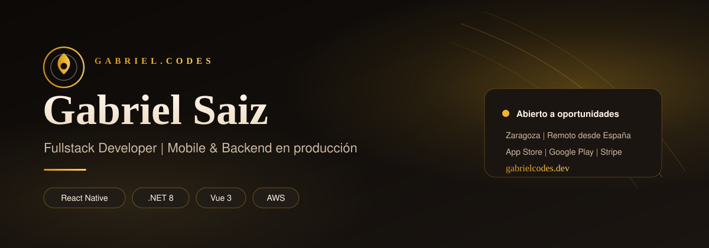
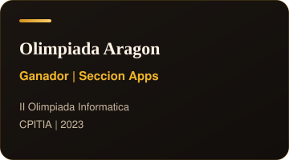
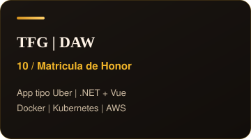

  

  

    
    
    
    
  

 

## Sobre mí

**Fullstack Developer** especializado en apps móviles y web que llegan a producción — no prototipos: software en stores, con pagos reales y usuarios concurrentes.

Busco incorporarme a un equipo con **producto propio** donde aportar fuerte en **mobile y backend**.

- Apps publicadas en **App Store** y **Google Play** (Stripe, IAP, SignalR, Apple Wallet)
- Stack: **React Native (Expo) · .NET 8 · Vue 3 · TypeScript · AWS**
- ~3 años con AWS: EC2, S3, RDS, Lambda, IAM, Docker y Kubernetes
- **Técnico Superior en DAW** — TFG con **10 / Matrícula de Honor**
- Ganador **NASA International Space Apps Challenge 2023** y **II Olimpiada Informática de Aragón**

 

## Stack en producción

  
    
  
  
  
  
  

 

## Experiencia

<table>
  <tr>
    <td width="50%" valign="top">
      <h3>Freelance Software Developer</h3>
      
<strong>Autónomo · Remoto</strong> 
      <em>Sep 2025 — Actualidad</em>

      
Apps móviles y web en producción. Publicadas en App Store y Google Play. Stripe, IAP, SignalR y Apple Wallet. Backend .NET 8 + PostgreSQL, paneles Vue 3 y despliegue en AWS.

      

        <code>React Native</code>
        <code>.NET 8</code>
        <code>Vue 3</code>
        <code>AWS</code>
      

    </td>
    <td width="50%" valign="top">
      <h3>Desarrollador Web — Dual</h3>
      
<strong>GOLIVE Services · Zaragoza</strong> 
      <em>Sep 2024 — Jun 2025</em>

      
Desarrollo y mantenimiento de aplicaciones web para clientes empresariales. PHP, Symfony, WordPress, Joomla y despliegues en AWS.

      

        <code>PHP</code>
        <code>Symfony</code>
        <code>WordPress</code>
        <code>AWS</code>
      

    </td>
  </tr>
</table>

 

## Reconocimientos

  
  
  

 

## Stats

  
  

 

## Formación

| | |
|---|---|
| **DAW — Desarrollo de Aplicaciones Web** | SEAS / Grupo San Valero · 2023–2025 · TFG **10 / MH** |
| **SMR — Sistemas Microinformáticos y Redes** | Centro San Valero · 2021–2023 |

 

  
    
  <a href="https://gabrielcodes.dev">Portfolio</a>
  ·
  <a href="https://www.linkedin.com/in/gabriel-saiz-de-la-maza-bajo-140370184/">LinkedIn</a>
  ·
  <a href="mailto:gsaiz.bajo@gmail.com">Email</a>

